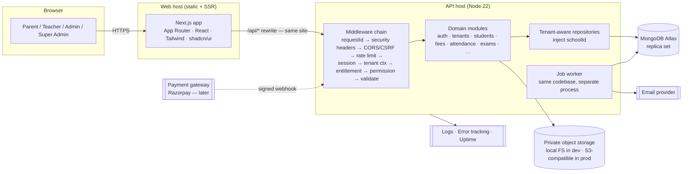

# D. System Architecture

## 1. Style: modular monolith, two deployables, one repo

*Beginner note:* a **monolith** is one backend program; "modular" means it's split into well-fenced internal modules (students, fees, …) that only talk through defined interfaces. Microservices would multiply deployment, cost and failure modes for no current benefit.



### Request lifecycle (every authenticated school request)

```
Browser ─► Next.js rewrite /api/* ─► Express
   1. assign requestId, start timer
   2. helmet headers, CORS allow-list, body size limit
   3. rate limit (IP + account)
   4. CSRF check (double-submit/Origin check for cookie-authenticated mutating requests)
   5. load session from cookie → user → active membership (DB, not token claims)
   6. set TenantContext{ schoolId, membershipId, roles } in AsyncLocalStorage   ← only source of schoolId
   7. entitlement check (module enabled & subscription state allows this method)
   8. permission check (route declares required permission)
   9. Zod validation of params/query/body (strict: unknown keys rejected)
  10. controller → service (business rules, record-scope, transactions) → repository (auto schoolId)
  11. audit event (for writes / sensitive reads)
  12. serialise through response DTO (explicit allow-list of fields) → JSON
  errors: single handler → { error:{ code, message, requestId, details? } }, no stack in prod
```

## 2. Technology choices and why

| Choice | Why | Alternative considered |
|---|---|---|
| **TypeScript strict** everywhere | Catches whole classes of bugs; AI-generated code is checked by compiler | JS — rejected |
| **npm workspaces monorepo** (`apps/web`, `apps/api`, `packages/shared`) | One repo; share Zod schemas, permission constants and types between UI and API so they can't drift | Two repos — drift risk; pnpm/turbo — extra tooling not needed yet |
| **Next.js App Router + Tailwind + shadcn/ui** | Your choice; shadcn copies components into repo (no runtime lock-in), accessible primitives (Radix) | — |
| **React Hook Form + Zod** | Same Zod schemas validate in browser and server | — |
| **TanStack Query** | Server-state caching, retries, pagination; avoids hand-rolled fetch state | SWR — equal; pick one, don't mix |
| **Recharts** | Your choice; only for real aggregated data | — |
| **Express 5 + Zod + Mongoose** | Your choice; mature; Mongoose gives schemas/hooks needed for tenant plugin | Fastify/Nest — good but you specified Express; revisit only if pain |
| **Argon2id (`argon2` pkg)** | Current best practice password hashing | bcrypt fallback if native build problems on host |
| **Opaque server-side sessions** (see §6) | Instant revocation, no JWT pitfalls | JWT+refresh — more moving parts |
| **pino** | Fast structured JSON logging with redaction | winston — slower, heavier |
| **helmet, express-rate-limit, cors** | Standard hardening, small | — |
| **Vitest + Supertest + Playwright** | Vitest = TS-native, fast; Supertest for HTTP; Playwright for E2E & responsive checks | Jest — fine, but extra TS config |
| **mongodb-memory-server (replica-set mode)** | Tests need real transactions; no cloud DB required for CI | Docker Mongo — heavier on Windows |
| **pdfmake** (or pdf-lib/pdfkit) for PDFs | Pure JS, runs on small hosts, embeds Indic fonts (Noto) | Puppeteer — needs Chromium, memory-hungry, awkward on free hosts |
| **exceljs + csv parser** | XLSX/CSV import-export | `xlsx` (SheetJS) npm has known licensing/security-advisory history → evaluate before adopting |
| **Mongo-backed job queue** (own tiny lease-based implementation) | Zero extra infra/cost | BullMQ needs Redis (cost) — swap in later |
| **File storage adapter** (`LocalFs`, `S3Compatible`) | Dev free; prod Cloudflare R2/S3 behind same interface | — |
| **Provider adapters** (Email/SMS/Payment) | Swap vendors without touching business code | — |
| **OpenAPI via `zod-to-openapi`** | Docs generated from the same Zod schemas → never stale | hand-written YAML — rots |

Rule: any new runtime dependency needs a one-line justification in `docs/dependencies.md` and a `npm audit` pass (your Rule 26).

## 3. Layering inside each backend module

```
route (declares permission, entitlement, schemas, rate-limit class)
  └─ controller   thin: parse → call service → shape response (no business logic)
       └─ service  business rules, record-scope checks, transactions, emits audit/events
            └─ repository  ONLY place that touches Mongoose models; auto-adds schoolId
                 └─ model  Mongoose schema + indexes
```
ESLint `no-restricted-imports` forbids importing models outside `*/repository` files. A second lint rule forbids `req.body.schoolId` / `req.params.schoolId` in school-scoped modules.

Cross-module calls go through the other module's **service interface** (`index.ts` exports), never into its repository or model.

## 4. Multi-tenancy summary (full design in doc 06)

Shared MongoDB database, shared collections, every tenant document carries `schoolId`; compound indexes start with `schoolId`; repository + Mongoose plugin inject and verify it; CI harness attacks every route with another tenant's identity. Reasoning: collection-per-tenant or DB-per-tenant gives stronger *physical* separation but multiplies indexes/connections/migrations and is impractical on small Atlas tiers for hundreds of schools. Revisit if a large school/chain demands it (could be offered later as a dedicated deployment using the same code).

## 5. Data & consistency rules

- **Transactions** (Mongo multi-document) for: payment + allocations + ledger + receipt number; refund approval; promotion batches (chunked); import commit chunks. Requires replica set (Atlas always; local dev via memory-server/replset). Verify the chosen Atlas tier supports transactions (generally yes — verify).
- **Money:** integer paise (`Number` safe up to 9×10¹⁵) — never floats. Display formatting only in UI.
- **Dates:** instants stored UTC `Date`; calendar days (attendance date, DOB, due date) stored as `"YYYY-MM-DD"` strings interpreted in the school's timezone — avoids off-by-one-day bugs.
- **Concurrency:** Mongoose `versionKey` optimistic locking on editable docs (409 on conflict); atomic `$inc` counters for sequences; unique indexes as the final guard for "no duplicates".
- **Idempotency:** `Idempotency-Key` header required on payment/collection and other money POSTs; stored with request hash; replay returns the original response; same key + different body → 422.
- **Soft delete:** `deletedAt/deletedBy` on non-financial records; repositories exclude by default; financial & academic records are **never** deleted — only status transitions/reversals.
- **Referential integrity:** MongoDB doesn't enforce it, so services validate referenced IDs belong to the same school and are in a valid state; "delete" is blocked if dependants exist.

## 6. Authentication architecture (one approach, documented)

**Choice: server-side sessions with opaque random tokens in an `HttpOnly; Secure; SameSite=Lax` cookie.**
- Token: 256-bit random; only its SHA-256 hash is stored in `sessions` (`userId, activeMembershipId, createdAt, lastSeen, expiresAt, ip, ua, revokedAt`).
- Idle timeout (e.g. 30 min web / 7 days "remember me" — configurable), absolute lifetime 30 days, rotation on privilege change/login.
- Logout/revoke = delete row → effective immediately. "Log out all devices" trivial. Deactivated membership → next request fails.
- **Why not JWT:** instant revocation and role changes matter for school staff turnover; JWT would need a denylist or short expiry + refresh rotation — more code, more bugs.
- **CSRF:** SameSite=Lax + Origin/Referer verification on state-changing requests + custom header (`X-Requested-With`) requirement. Webhooks are exempt but signature-verified.
- **The cookie problem you didn't ask about:** if web and API are on different registrable domains (e.g. `*.vercel.app` + `*.onrender.com`), cookies become third-party and get blocked. **Fix:** serve the API through the web app's own domain via Next.js rewrites (`/api/* → API host`) or use `app.edunex.in` + `api.edunex.in` under one registrable domain. Requires owning a domain (decision D-02).
- Password reset & invite tokens: single-use, hashed at rest, 30–60 min expiry, never in logs, sent only in email link.
- Account lockout: progressive delay + temporary lock after N failures, per account *and* IP; generic error messages (no user enumeration).
- MFA: TOTP (P1), mandatory for platform staff.

## 7. Notifications & jobs architecture

`domain event → NotificationService.enqueue(template, recipient, channel, dedupeKey) → jobs collection → worker → adapter → delivery record`.
Worker runs as a second process (`node dist/worker.js`) on the same host. Jobs have `status, attempts, nextRunAt, lockedUntil`; workers claim with `findOneAndUpdate` (atomic). Retries with exponential back-off, dead-letter after N tries, all visible in Super Admin health page.

## 8. Files

`FileService.upload()` → validate (size, MIME by magic-bytes, extension allow-list, no SVG/HTML/exe) → store with random key under `schools/{schoolId}/…` → `files` doc. `FileService.getDownload(fileId)` → loads doc via tenant repo (so another tenant's id = 404) → checks the *owning entity's* permission (e.g. may this guardian see this child's document?) → returns 5-min signed URL (prod) or streams (dev) with `Content-Disposition` and `X-Content-Type-Options: nosniff`.

## 9. Observability

- pino JSON logs with `requestId`, `schoolId`, `userId`, route, latency; **redaction list** for `password`, `token`, `authorization`, `cookie`, payment fields. No request bodies logged by default.
- `/health/live` (process) and `/health/ready` (DB reachable).
- Error tracking (Sentry free tier — verify terms) with PII scrubbing.
- Audit log is a *product feature* (queryable by school), separate from technical logs.

## 10. Environments

`local` (Docker-less: Node + memory-server or Atlas dev cluster) · `staging` (synthetic data only) · `production` (real data, separate DB, separate secrets, separate payment keys — *test and live keys never mix*). Config via validated env (Zod parse at boot; app refuses to start on missing/invalid). Details in doc 12.

## 11. Performance posture

Indexes designed with queries (doc 05); mandatory pagination (`limit ≤ 100`, cursor or page); `lean()` for read lists; aggregate dashboards served from precomputed daily rollups where counts get heavy (P2); no N+1 (batch `$in` lookups in services); request timeout 30 s; Mongo `maxTimeMS` on reports; large exports → job + download link. Load-test dataset target: 20 schools × 1,500 students × 1 year of attendance (~6.6 M attendance docs).
**Attendance modelling decision:** one document per student per day (`attendance_records`), written with a single `bulkWrite` upsert per class save. Chosen over a per-class-day document with an embedded roster because the DB itself can then enforce "no duplicate attendance" via a unique index `(schoolId, studentId, date)`, student-level queries/corrections are trivial, and there are no growing arrays. Cost: more documents (~330 k/school/year ≈ tens of MB — fine). If volume ever hurts, add a monthly per-student summary rollup (`attendance_monthly`) rather than changing the base model. Recorded in doc 05.

## 12. Portability and environment separation (added in rev 2 — D-19)
The application must run unchanged on free development infrastructure and on paid production infrastructure. Rules (full list in [doc 12 §11](12-deployment-infra.md)): plain Node 22 servers (Next.js `output: 'standalone'`); MongoDB via connection string only, **no Atlas-only features**; storage/email/payment/SMS behind adapters; all environment differences in validated env vars; same-site `/api/*` proxy; standard `mongodump/mongorestore` backups. Real data exists only in production; dev and staging are synthetic-only (doc 12 §2).

> **Rev 3 note:** the architecture choices in this document are **conditional (D-23)** until you approve the individual ADRs in [16-architecture-decision-records.md](16-architecture-decision-records.md). Where this document and doc 16 differ, doc 16 is the more recent and detailed statement.
