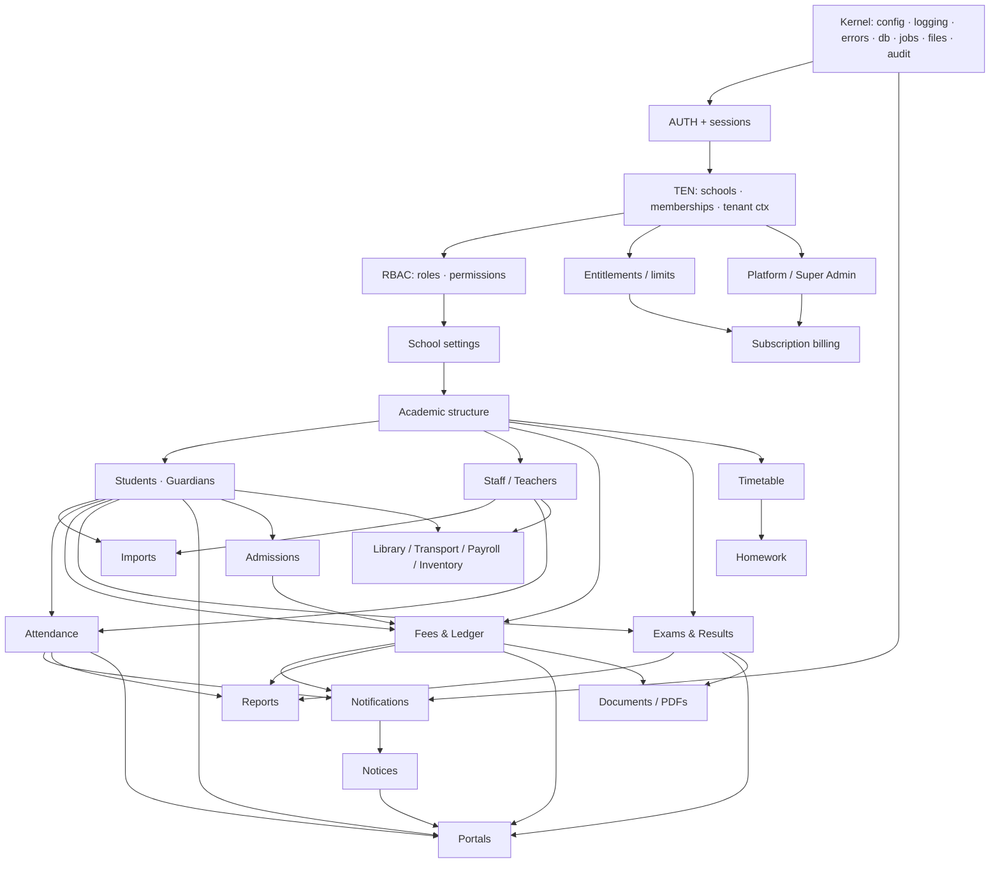

# J. Module Dependency Map & Proposed Phase Re-order

## 1. Dependency graph (arrow = "needs")

## 2. Problems with the spec's phase order (§45) — and proposed fixes

| # | Issue in original order | Why it matters | Proposed change |
|---|---|---|---|
| 1 | Phase 3 (Auth & RBAC) before Phase 4 (Tenant) | A login needs **memberships** (tenant concept) to know which school/roles; RBAC permissions are per-school. Circular. | Merge: **Phase 3 = Identity + Tenancy + RBAC kernel** together (users, sessions, schools, memberships, roles, tenant context, audit, isolation harness skeleton). |
| 2 | Audit logging and file storage appear late (Phase 5/12) | Needed from the first write (audit) and by Phase 7 (student photos/documents) | Build **audit + file service + job queue + idempotency + sequences** in the foundation phase. |
| 3 | Entitlements/limits only in Phase 13 | Student/staff limits and module gates must exist when those modules are built (else retrofit risk — T25) | Add a **minimal entitlement service** (plan limits + feature flags, manual assignment by Super Admin) in Phase 3/5. Billing automation stays Phase 13. |
| 4 | Imports (§37) not in any phase | Pilot school's first need is Excel import | Add **Import** to Phase 7 (students/guardians/classes/staff). Fee-balance import after FEE. |
| 5 | Background jobs / notification adapters not scheduled | Imports, PDFs and email all need them | Include in foundation phase (jobs) and Phase 8 (notification adapters). |
| 6 | Parent portal in Phase 11, after Finance/Exams | Fine for dependencies, but parents are the pilot's most visible win and can ship as **read-only slices** as each data module completes | Ship parent views incrementally: attendance (P8), fees (P9), results (P10) rather than one big Phase 11. |
| 7 | Finance before Exams | Reasonable — finance is higher risk & value | Keep. |
| 8 | Phase 14 (security/isolation audit) at the end | Isolation tests must exist **from Phase 3** and grow per module; a final audit is a re-check not the first check | Per-module isolation tests are part of each phase's exit; Phase 14 becomes a *full independent re-audit + load test*. |
| 9 | Timetable & Homework in "core" Phase 8 | Not pilot-blocking; conflict detection adds complexity | Move to **P1 release** (after pilot go-live). |
| 10 | Super Admin full (Phase 5) before any school module | Over-builds vendor tools before product exists | Phase 5 reduced to **minimal console**; richer analytics/support after pilot. |

## 3. Revised phase plan — Revision 2 (supersedes the earlier 12-phase table and rows 2, 5 and 10 above where they conflict)

**Why it changed:** D-04 (5–10 h/week) and D-19 (₹0/month production) make a single MVP drop unrealistic and make real-data go-live conditional on a gate. The plan is now organised in **releases**; each release ends with a regression + isolation + security re-check, a restore-drill refresh, and the phase completion report, then **waits for your approval**.

### 3.1 Dependency changes
| Change | Effect |
|---|---|
| **Job queue → R3** (was foundation) | Off the R1 critical path. R1 import is synchronous, capped (~2,000 rows, chunked transactions); email adapter is synchronous. `JobQueue` interface + `jobs` schema designed in Phase 1 |
| **Sync email adapter → Phase 3** | Required by invites and password reset |
| **Platform web console → R5**; R1 provisioning by **CLI** | No web Super-Admin login in R1; MFA-for-platform-web deferred with the console |
| **File uploads → R2/R3** | R1 has no photos/documents; `FileService` interface/schema designed early |
| **Parent portal → R3**; guardian-link model built/tested in R1 | Portal depends on R1 links + R2 fees (for fee views) |
| **Promotion/rollover → R5, deadline-bound** | Pull forward ≥ 3 months before the first year-end after go-live |
| **Production-Readiness Gate (doc 12 §10) inserted** between "R1 build complete" and any real data; re-checked (delta) for R2 and R4 | New hard dependency for every go-live |
| **Funding path (D-26)** | Hard dependency of Gate G9; not a dependency of building |

### 3.2 Phases (new numbering; Phase 0 done)

| Phase | Release | Content | Exit gate (tests/evidence must pass) |
|---|---|---|---|
| 0 | — | Discovery (docs, rev 2) | You approve docs + decisions |
| 1 | R1 | Architecture finalisation: requirement register CSV, ADRs, Zod/Mongoose skeleton design, OpenAPI skeleton, verification-log started | Review |
| 2 | R1 | **Foundation:** monorepo, strict TS, lint rules (incl. tenancy), env validation, logging, DB, errors, CI, replica-set test infra, health, Dockerfile (optional path) | CI green; app boots; **re-baseline #1** |
| 3 | R1 | **Identity + Tenancy + RBAC + Audit kernel** (internal order 3a tenancy primitives → 3b identity → 3c membership binding → 3d authorization → 3e audit + isolation harness; see ADR-7, doc 16): users, sessions, schools, memberships, roles, tenant plugin/repos, entitlement-lite, idempotency & sequences, sync email adapter, **isolation harness v1** | Auth/RBAC tests; isolation suites 1–14 on existing routes; **re-baseline #2** |
| 4 | R1 | School setup (profile, policies, session, classes, sections, subjects, assignments, holidays), users/roles screens, **CLI provisioning** | Acceptance + isolation for new routes |
| 5 | R1 | Students, guardians (+links), staff-basic, **CSV/XLSX import/export** | Scope/isolation tests; import tests incl. bad rows; formula-injection test |
| 6 | R1 | **Attendance** (+ audited edits, reports) with teacher mobile view | Duplicate/scope/policy/concurrency tests |
| 7 | R1 | **Hardening:** security review, perf test with realistic data, accessibility/mobile checks, deployment, monitoring, **backups + restore drill**, runbooks → **Gate evidence** | R1 acceptance + Gate G1–G7, G9 |
| — | — | **PILOT ONBOARDING only after the Gate passes** (parallel-run) | doc 12 §10 + doc 15 §6 |
| 8 | R2 | **Fees & ledger** (config, invoices, collection, receipts PDF, reversal/refund, day-book/close, reports) + file service for receipts | Finance suite; ledger invariants; Gate G8 |
| 9 | R3 | Job queue, notices (in-app + email), notification consent, **parent portal** | Parent scope tests; delivery-status honesty tests |
| 10 | R4 | Exams, marks, results, report card | Grading/rounding/absent/optional tests |
| 11 | R5 | Promotion/rollover (pull forward if year-end approaches), platform web console, platform MFA | Promotion-preserves-history test; platform separation suite |
| 12+ | post | P1/P3 modules by pilot feedback | per-phase protocol |

(Option B — fees first — was considered and **not selected**; D-27 = Option A. R1 = Student Management & Attendance Pilot.)

### 3.3 Critical path
`Foundation → Identity/Tenancy/RBAC/Audit → School setup → People+Import → Attendance → Hardening/Deploy/Backups → **Gate** → Pilot`.
Off the critical path for R1: job queue, platform console, files, parent portal, notices, fees, exams, promotion (but promotion is deadline-bound).
